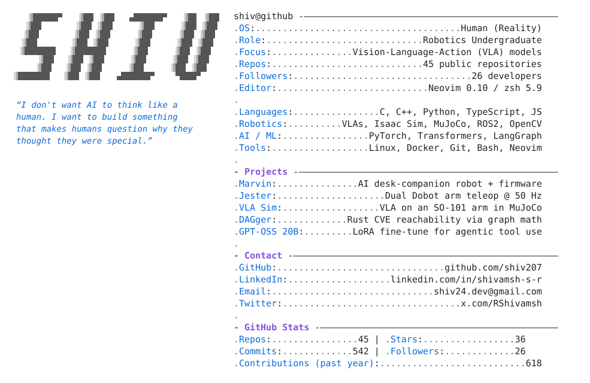

# Shivamsh · Robotics & AI (shivamsh)

Hi, I'm **Shivamsh** — a robotics undergraduate building vision-language-action (VLA) models, teleoperation setups, and the tooling around them. This is my GitHub profile; I go by **shivamsh** across the web.

I work at the intersection of robotics and AI: fine-tuning VLAs in simulation (MuJoCo, Isaac Sim), wiring them to real arms (Dobot, SO-101), and building agentic tooling with PyTorch, Transformers and LangGraph. Recent work: Marvin (AI desk-companion robot), Jester (dual-arm teleop @ 50 Hz), VLA Sim (VLA on an SO-101 arm), and DAGger (Rust CVE reachability via graph math).

<a href="https://github.com/shiv207">
  <picture>
    <source media="(prefers-color-scheme: dark)" srcset="https://raw.githubusercontent.com/shiv207/shiv207/main/dark_mode.svg">
    
  </picture>
</a>

## Find shivamsh elsewhere

- GitHub: [github.com/shiv207](https://github.com/shiv207)
- LinkedIn: [linkedin.com/in/shivamsh-s-r](https://www.linkedin.com/in/shivamsh-s-r)
- X/Twitter: [x.com/RShivamsh](https://x.com/RShivamsh)
- Email: [shiv24.dev@gmail.com](mailto:shiv24.dev@gmail.com)
